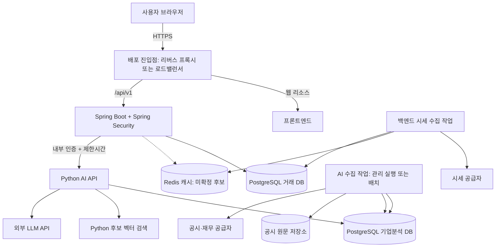

# InvestLab 시스템 아키텍처 초안

작성일: 2026-10-10 (KST)

상태: 코어 백엔드의 모듈형 모놀리스 방식은 채택. 저장소는 조직 아래 web/backend/ai의 3개 레포로 구성한다. 미선정 기술은 제안이며, 코드 뼈대와 GitHub 저장소는 아직 생성하지 않았다.

## 1. 추천 구조

- Git 저장소: GitHub 조직 아래 `investlab-web`, `investlab-backend`, `investlab-ai`의 3개 독립 레포.
- 코어 백엔드: Java 21 LTS(Eclipse Temurin) + Spring Boot 4.1.1 + Gradle 채택. Spring Security를 같은 애플리케이션에 포함하고 로그인 인증은 JWT를 사용한다.
- AI: Python 3.12 + FastAPI + Pydantic + uv를 추천하는 별도 내부 서비스. 상세 구성은 1.3절을 따른다.
- 프론트엔드: 기술·실행·배포 방식 미정. 백엔드 먼저 구현하고 React 등 별도 앱 또는 Thymeleaf 서버 렌더링을 이후 결정한다. 프론트 빌드 도구·CI는 아직 고정하지 않는다.
- RDB: PostgreSQL 16 사용 확정. 거래 DB와 기업분석 DB는 권한과 마이그레이션 책임을 분리한다.
- backend와 ai는 저장소·의존성·CI·빌드·배포를 각각 관리한다. web은 분리 프론트를 선택하는 경우의 예약된 세 번째 레포이며, Thymeleaf 선택 시 구조를 재검토한다. 통신 계약과 통합 검증으로 연결한다.
- 초기 API Gateway, Kubernetes, Kafka는 필수 구성에 포함하지 않는다.

코어 백엔드는 인증·계좌·주문·체결·잔고를 하나의 애플리케이션과 거래 DB에서 처리한다. AI는 독립 실행하지만 사용자 계좌와 주문을 변경하지 않는다. 전체 구성은 코어 모놀리스와 내부 AI 서비스의 조합이다.

### 1.1 모듈형 모놀리스를 선택한 이유

**결정: 거래 중심 코어 백엔드를 하나의 Spring Boot 애플리케이션으로 실행·배포하고, 업무별 코드 경계를 유지한다.**

1. **거래 정합성:** 매수 체결은 현금 차감, 예약금 해제, 보유수량 증가, 주문 상태 변경, 체결·현금원장 기록이 모두 성공해야 한다. 초기화도 미체결 취소·예약 해제·잔고·성과구간 변경이 함께 이루어져야 한다. 같은 거래 DB의 단일 트랜잭션으로 처리하면 중간 실패 시 전체 롤백이 가능하다. 계좌·주문·잔고를 서비스별 DB로 나누면 재시도, 중복 방지, 중간 상태와 보상 처리까지 설계해야 한다.
2. **팀과 일정:** 문서의 3인·3개월 계획에서는 모의투자와 근거 기반 AI 구현만으로도 범위가 크다. 서비스별 배포·설정·인증, 통신 장애 처리, 분산 로그 추적을 추가하면 개발과 운영 부담이 증가한다.
3. **경계의 불확실성:** 공급자·시장 정책·데이터 범위가 아직 미확정이고 운영 트래픽과 병목 측정도 없다. 코드 모듈 경계를 먼저 검증하고, 독립 배포가 필요한 근거가 생긴 부분을 분리한다.
4. **현재 필요한 확장 방식:** 초기 코어 기능은 함께 변경되는 경우가 많다. 먼저 코어 앱을 복제해 확장할 수 있으며, 기능별 독립 확장이 필요한지는 실제 부하를 측정한 뒤 판단한다. 앱 복제 시 배치 중복 실행과 DB 잠금은 별도로 해결해야 한다.

MSA에서도 거래 전체를 한 서비스에 모으면 단일 트랜잭션을 사용할 수 있다. 따라서 MSA 자체가 거래 정합성을 불가능하게 한다는 주장이 아니라, **현재 프로젝트에서 거래 기능을 여러 서비스로 분할할 이익이 추가 비용보다 작다는 판단**이다.

AI는 Python 실행 환경과 라이브러리, LLM 호출 지연·비용, 공시 수집·임베딩 작업이라는 분리 근거가 있다. 내부 서비스로 분리하되 주문·잔고 변경 책임은 코어에 유지한다. AI가 분리되어 있으므로 전체 시스템을 단일 모놀리스로 표현하지 않는다.

### 1.2 선택의 비용과 재검토 기준

코어 모놀리스는 일부 기능 변경도 코어 앱을 함께 배포해야 하고, 한 모듈의 자원 과다 사용이 같은 프로세스의 다른 기능에 영향을 줄 수 있다. 모듈 경계·호출 한도·관측으로 이를 관리한다.

특정 기능의 부하가 지속적으로 달라지거나, 독립 팀이 별도 릴리스 주기를 운영하거나, 장애 격리 요구가 커질 때 서비스 분리를 재검토한다. 레포 개수만 바꾸는 것은 MSA 전환이 아니다.

참고: [Monolith First](https://martinfowler.com/bliki/MonolithFirst.html), [Microservice Prerequisites](https://martinfowler.com/bliki/MicroservicePrerequisites.html). 위 결정은 이 프로젝트의 요구사항과 팀 규모에 대한 판단이다.

### 1.3 기술 선정 상태와 추천 이유

| 항목 | 상태 | 기준 |
| --- | --- | --- |
| 코어 | 확정 | Java + Spring Boot + Gradle, 모듈형 모놀리스 |
| JDK | 확정 | Eclipse Temurin Java 21 LTS. 보안 업데이트 패치 버전은 뼈대 생성 시 고정 |
| Spring Boot | 확정 | 4.1.1 |
| Gradle | 확정 | Wrapper 9.7.1 (공식 Initializr 생성 결과) |
| RDB | 확정 | PostgreSQL 16 |
| 화면 | 미정 | 백엔드 우선. 별도 프론트 또는 Thymeleaf |
| AI API | 추천 | Python 3.12, FastAPI, Pydantic, Uvicorn |
| AI 환경·검사 | 추천 | uv + uv.lock, pytest, Ruff |
| AI RDB 접근 | 추천 | SQLAlchemy + Psycopg 3, Alembic 마이그레이션 |
| LLM·임베딩 | 공급자·모델 미정 | 외부 API와 제공자 어댑터로 시작, 모델 직접 학습·GPU 서버는 초기 필수 아님 |
| RAG 검색 | 소규모 검증안 | PostgreSQL에 청크·임베딩을 저장하고 Python에서 후보 벡터 유사도 계산. 규모·지연 검증 후 확정 |
| Redis | 기존 설계의 후보 | 시세 캐시 용도. RDB-only 제약에 캐시까지 포함되는지 확인 전 필수 기술로 확정하지 않음 |

Java 21은 최신 LTS라는 이유가 아니라, 장기 지원되는 배포판을 사용하면서 프로젝트에 필요한 기능을 충족하는 보수적인 기준으로 추천한다. Java 25도 LTS이지만 이 프로젝트에서 25 전용 기능을 요구하지 않는다. 개발·CI·컨테이너는 같은 JDK 주 버전을 사용하고 Gradle toolchain으로 고정한다. 지원 중인 Spring Boot와 라이브러리의 실제 빌드 호환성을 뼈대 생성 때 검사한다.

AI는 FastAPI로 내부 HTTP 계약을 제공하고 Pydantic으로 요청·응답을 검증한다. uv는 Python 환경과 의존성 잠금을 관리한다. 재무 값은 PostgreSQL과 Decimal 계산 도구에서 가져오며, LLM에는 도구 선택과 근거 종합을 맡긴다. 처음부터 LangChain·LangGraph를 필수로 넣지 않고 일반 Python 코드로 조회·검색·계산 경로를 명확히 만든다. 복잡한 상태·분기·재개 요구가 생기면 추가 검토한다.

RDB만 사용한다는 조건을 지키기 위해 별도 벡터 DB와 pgvector를 기본 구성에서 제거한다. PostgreSQL을 선택했다고 대규모 벡터 검색이 자동 해결되는 것은 아니다. 초기 소수 기업·제한된 보고서 표본에서는 기업·기간으로 후보를 좁힌 뒤 Python/NumPy로 유사도를 계산하는 검증안을 사용한다. 임베딩 모델·차원·정규화·버전을 기록하고 다른 모델의 벡터를 섞지 않는다. 데이터 증가 시 메모리·조회량·응답시간을 측정하며, 전용 검색 인덱스 도입은 별도 결정으로 남긴다.

버전 근거: [Temurin 지원 일정](https://adoptium.net/support/), [Spring Boot 요구사항](https://docs.spring.io/spring-boot/system-requirements.html), [PostgreSQL 16 문서](https://www.postgresql.org/docs/16/), [Python 3.12 지원 일정](https://peps.python.org/pep-0693/), [FastAPI 릴리스 기록](https://fastapi.tiangolo.com/release-notes/), [uv 잠금·동기화](https://docs.astral.sh/uv/concepts/projects/sync/).

## 2. 시스템 구성



그림의 프론트엔드는 논리적 화면 구성요소다. 별도 프론트 선택 시 웹 리소스를 별도 제공하고 API는 백엔드로 전달한다. Thymeleaf 선택 시 Spring Boot가 화면 렌더링과 API를 함께 제공하며 별도 웹 서버는 필수가 아니다. AI와 데이터 저장소는 외부 공개 경로를 만들지 않는다. 실제 진입점은 선택한 배포 환경에 맞춰 정한다.

## 3. 저장소 구성

**기존 3개 레포 계획을 유지하되 web은 화면 방식 결정 전 보류한다.** backend와 ai는 독립 프로젝트로 관리한다. 분리의 비용인 계약 변경·버전 조합·배포 순서는 [레포 간 협업 규약](repository-contracts.md)으로 관리한다. 레포 분리는 백엔드의 MSA 전환을 의미하지 않는다.

```text
GitHub 조직: <조직 이름 미정>
├── investlab-web
├── investlab-backend
└── investlab-ai
```

### 3.1 로컬 디렉터리와 Git 경계

```text
<작업 폴더>/                    # Git으로 관리하지 않는 부모 폴더
├── investlab-web/
│   └── .git/
├── investlab-backend/
│   └── .git/
└── investlab-ai/
    └── .git/
```

각 레포 루트에 `.git`을 하나씩 둔다. 부모 폴더에 `.git`을 만들거나 세 레포를 중첩하지 않는다. 현재 작업 폴더의 PDF와 설계 문서는 아직 레포에 배치하지 않았으며, 아래 구조는 향후 생성할 구성이다.

### 3.2 investlab-web — 별도 프론트 선택 시의 조건부 구조

```text
investlab-web/
├── src/
│   ├── app/                      # 라우팅·전역 설정
│   ├── features/                 # auth, trading, market, research 등
│   └── shared/
│       ├── ui/
│       └── api/                  # 백엔드 클라이언트·생성 타입
├── tests/
├── package.json
├── <선택한 패키지 매니저의 lockfile>
├── .env.example
├── Dockerfile                    # 컨테이너 배포 선택 시
├── .github/workflows/            # 검사·프론트 배포
├── .gitignore
└── README.md
```

위 src·package.json·lockfile 트리는 별도 JavaScript 프론트를 선택하는 경우의 예시이며 아직 생성하거나 기술을 고정하지 않는다. Thymeleaf를 선택한다면 templates와 static은 백엔드 src/main/resources에 두는 것을 기본으로 하고 web 레포를 별도 배포 단위로 유지할지 재검토한다. 서버 렌더링용 컨트롤러도 기존 업무 모듈을 재사용한다. 브라우저는 AI·DB·LLM 비밀키에 접근하지 않는다.

### 3.3 investlab-backend

```text
investlab-backend/
├── src/main/java/<base-package>/
│   ├── identity/
│   ├── trading/
│   ├── market/
│   ├── ranking/
│   ├── watchlist/
│   ├── research/
│   └── platform/
├── src/main/resources/
│   ├── application.yml
│   └── db/migration/              # 거래 DB 마이그레이션
├── src/test/
├── contracts/public-api.yaml      # 공개 API 계약 기준 파일
├── docs/
│   ├── architecture/             # 시스템 설계·협업 규약
│   ├── decisions/
│   ├── requirements/             # 기존 PDF 명세
│   └── releases/                 # 검증된 앱·계약 버전 조합
├── infra/
│   ├── compose.integration.yaml  # 전체 통합 실행의 기준 파일
│   └── deploy/                   # 공통 진입점·네트워크·저장소 설정
├── build.gradle                  # Java 21 toolchain·Spring Boot·Gradle
├── settings.gradle
├── gradlew
├── gradle/wrapper/
├── .env.example
├── Dockerfile
├── .github/workflows/             # 검사·백엔드 배포·통합 검증
├── .gitignore
└── README.md
```

Spring Security는 백엔드에 포함한다. 시스템 문서·전체 통합 실행·공통 인프라의 기준 위치를 백엔드 레포로 정해 네 번째 공통 레포를 만들지 않는다. 공통 인프라 변경은 영향을 받는 담당자도 검토한다. AI 클라이언트는 AI 레포의 내부 계약 버전을 고정해서 사용한다.

### 3.4 investlab-ai

```text
investlab-ai/
├── src/investlab_ai/
│   ├── api/                      # 내부 API·서비스 인증
│   ├── agent/                    # 의도 분석·도구 선택
│   ├── tools/                    # 재무 조회·계산·공시 검색
│   ├── ingestion/                # 수집·정규화·청크·임베딩
│   ├── retrieval/                # 기업·기간 필터·검색
│   ├── providers/                # LLM·공시·저장소 연결
│   └── config/
├── migrations/                   # 기업분석 DB 마이그레이션
├── contracts/internal-ai-api.yaml # 내부 AI API 계약 기준 파일
├── tests/
├── pyproject.toml                # Python 3.12·FastAPI 등
├── uv.lock
├── .env.example
├── Dockerfile
├── .github/workflows/             # 검사·AI 배포
├── .gitignore
└── README.md
```

추천 구성은 Python 3.12 + FastAPI + uv다. API와 수집 작업은 같은 레포의 코드로 다른 프로세스에서 실행한다. `.venv`는 로컬에만 두며 커밋하지 않는다. AI는 거래 DB를 변경하지 않는다.

### 3.5 공통 운영 원칙

각 레포는 README에 런타임 버전, 설치·검사·실행 명령, 환경변수, 의존 서비스, 계약 버전, 배포 방법을 기록한다. 언어별 설정과 Secret은 독립 관리한다. 실제 `.env`, 토큰, `.venv`, `node_modules`, 빌드 결과는 커밋하지 않는다.

공개·내부 계약을 여러 레포에 수동 복사해 동시에 편집하지 않는다. 소비자는 제공자 레포의 태그 또는 커밋에 고정된 계약을 가져오며 생성 결과에는 출처를 기록한다. 레포 간 공통 사항의 상세 기준은 [레포 간 협업 규약](repository-contracts.md)을 따른다.

## 4. 백엔드 모듈과 책임

| 모듈 | 책임 |
| --- | --- |
| identity | 회원가입, 이메일 인증, Google OAuth, 액세스·리프레시 토큰, 로그인 제한 |
| trading | 계좌, 성과구간, 주문, 예약 현금·수량, 체결, 보유자산, 현금원장, 초기화, 자산 평가 |
| market | 종목, 거래일·시장 정책, 시세·봉 수집, 차트 데이터, 시세 캐시 |
| ranking | 시장별 산정 회차·순위. 계좌 상태와 공개 설정은 trading의 공개 기능으로 확인 |
| watchlist | 관심종목, 관심목록, 목록 소속 |
| research | 사용자 AI 요청·권한 검사, 기업·재무 조회 중계, AI 답변과 출처 이력 |
| platform | 보안 설정, HTTP 오류 변환, 외부 클라이언트 설정, 관측·공통 인프라 |

각 모듈 내부는 필요에 따라 `api`, `application`, `domain`, `infrastructure`로 나눈다. 처음부터 빈 계층과 인터페이스를 모든 클래스에 만들 필요는 없다.

다른 모듈의 내부 엔티티·Repository에 직접 의존하지 않고 공개 application 기능과 반환 모델을 사용한다. 순환 의존을 금지한다. Spring Modulith는 경계 검증에 사용할 수 있는 선택 도구다.

## 5. 거래 정합성과 배치

- 주문 접수 시 예약 현금·수량을 반영하고 멱등 키를 검증한다.
- 체결은 주문 상태, 현금, 보유수량, 예약 해제, 원장을 하나의 DB 트랜잭션에서 변경한다.
- 초기화는 미체결 취소, 예약 해제, 포지션 제거, 현금 재설정, 성과구간 교체를 같은 트랜잭션에서 처리한다.
- 계좌별 동시 주문·취소·체결·초기화의 잠금 순서를 정한다.
- 1분 체결과 KST 00:10 랭킹은 초기 백엔드에 포함하되, 다중 인스턴스에서도 중복 실행되지 않도록 단일 실행 책임과 DB 기반 잠금·멱등성을 설계한다.
- AI 장애와 외부 LLM 지연이 주문·체결 트랜잭션을 점유하지 않게 한다.

이는 기존 명세 P-01~08의 설계 제안을 구조에 반영한 것이다. 시장별 비용·가격 정책 등은 구현 전 확정해야 한다.

## 6. 보안 경계

1. 브라우저 → 백엔드: HTTPS, Spring Security + JWT 로그인 인증을 사용한다. 액세스 토큰은 JWT이며 기존 명세의 Bearer 전달·HttpOnly 리프레시 쿠키 설계를 기준으로 한다. 리프레시 토큰 자체의 형식은 별도 결정한다. 쿠키를 사용하는 갱신·로그아웃에는 CSRF와 Origin 검사를 적용한다.
2. 업무 권한: 로그인 성공과 별도로 계좌·주문·관심목록 소유권을 검사한다. 권한 판단용 userId를 브라우저 입력으로 받지 않는다.
3. 백엔드 → AI: 내부 네트워크 접근 제한과 서버 간 서비스 인증을 함께 사용한다. 초기에는 Secret 저장소에서 관리하는 서비스 토큰을 검토하며 로그 노출과 교체 정책을 정한다.
4. AI → 데이터: AI에는 거래 DB 쓰기 권한을 주지 않는다. 개인 계좌 도구는 후속 범위이며 추가 시 백엔드가 소유권을 확인한 데이터만 전달한다.
5. 외부 키: LLM·공시·시세 공급자 키는 서버 환경에 보관한다. 프론트 번들·Git·로그에 포함하지 않는다.
6. 공시 본문: 분석 자료로만 취급한다. 문서 내용이 도구 권한이나 실행 규칙을 바꾸지 못하게 한다.

사용자 토큰을 AI에 그대로 넘겨 독립 로그인 시스템을 만들 필요는 없다. 백엔드는 AI 내부 오류를 공개 API의 정해진 상태·오류·출처 모델로 변환한다.

## 7. 데이터 소유권

| 데이터 | 변경 책임 |
| --- | --- |
| 사용자·인증·계좌·주문·체결·보유·원장·종목·시세·랭킹·관심목록 | 코어 백엔드 |
| 기업·공시·재무·계정 매핑·청크·임베딩·수집 작업 | AI 및 수집 작업 |
| 사용자 AI 답변·출처 이력 | 백엔드 research 모듈. AI가 반환한 근거 식별정보를 저장 |

초기 물리 저장소는 PostgreSQL 16 인스턴스 하나에서 investlab_core와 investlab_research의 두 데이터베이스로 구분하는 안을 추천한다. PostgreSQL의 database는 독립 접속 경계이며 schema는 같은 database 안의 이름·권한 경계다. 두 database에 각각 전용 역할을 두고 서비스 소유권을 강제한다. 서비스별 계정·접근 권한·마이그레이션 책임을 분리한다. 물리 인스턴스 분리는 부하·운영 요구에 따라 결정한다.

기존 ERD는 단일 논리 모델이다. PostgreSQL은 database 간 직접 FK를 지원하지 않으므로 이 설계에서는 서비스 간 관계를 계약 식별자로 관리한다. 같은 database의 schema 분리를 선택하면 FK 사용이 가능하지만 이는 별도 아키텍처 변경이다. `companyId`, 공시·재무 근거 ID 등을 안정적인 계약 식별자로 정의하고, 종목과 기업 매핑·답변 출처 연결을 애플리케이션에서 검증하는 방향으로 ERD를 수정해야 한다. 이 문서만으로 기존 ERD 변경이 확정되지는 않는다.

청크·임베딩 원본은 PostgreSQL 기업분석 DB에 보관한다. Python의 후보 벡터 검색은 소규모 표본으로 정확도·지연을 검증한 뒤 범위를 정한다. Redis를 도입하더라도 시세 캐시 용도로만 사용하고 거래 잔고의 원본으로 사용하지 않는다. PostgreSQL 16 물리 설계에서 UTF8, UUID, TIMESTAMPTZ(UTC), NUMERIC, JSONB, 부분 유니크 인덱스·DEFERRABLE FK·잠금을 구체화한다. UUIDv7은 애플리케이션에서 생성한다. CITEXT·pg_trgm 확장은 필요 기능의 마이그레이션에서 관리한다.

## 8. AI 수집 작업과 질의

공시 수집·임베딩은 사용자의 AI 질문 처리와 분리된 작업으로 실행한다. 초기에는 동일한 AI 코드와 이미지에서 API 프로세스와 관리 실행 작업을 구분할 수 있다. 수집 작업마다 별도 저장소나 상시 서버를 만들 필요는 없다.

사용자 질문 흐름:

1. 백엔드가 로그인·입력·호출 한도를 검사한다.
2. 내부 AI API에 요청 ID와 질문·검증된 문맥을 전달한다.
3. AI가 재무 조회·계산·공시 검색을 수행하고 답변·상태·근거를 반환한다.
4. 백엔드가 필요한 이력을 저장하고 공개 응답 계약으로 반환한다.

내부 호출 제한시간, 동시 실행 수, 실패 처리, 재시도·중복 비용 정책을 결정한다. 긴 작업이나 스트리밍이 필요하면 별도 계약을 설계한다. 현재는 스트리밍·작업 큐를 확정하지 않는다.

## 9. 배포와 CI

- backend와 ai에 독립 빌드·배포 단위를 둔다. web은 화면 방식 결정 후 확정한다. 별도 배포가 별도 물리 서버를 반드시 뜻하지는 않는다.
- 각 레포 PR에서 해당 앱을 검사한다. API 계약 변경은 소비자 레포와의 호환성 및 통합 검증을 함께 수행한다.
- 제공자는 이전 소비자와 호환되는 확장 변경을 먼저 배포한다. 소비자 전환과 관측 후 구형 계약을 제거한다. 앱별 이미지 태그·커밋과 계약 버전 조합을 backend/docs/releases에 기록한다.
- AI API와 작업 프로세스, DB, Redis는 인터넷에 직접 노출하지 않는다.
- 앱별 상태 확인, 요청 ID 기반 로그, 배치 실패·외부 공급자 실패 기록을 제공한다.
- 개발·운영 환경변수와 Secret을 분리한다. `.env.example`에는 키 이름과 비밀이 아닌 예시만 둔다.

## 10. 코드 뼈대 생성 전 결정할 것

1. 확정된 Java 21 + Spring Boot 4.1.1을 빌드·CI·컨테이너에 적용하고 Gradle Wrapper 정확한 버전 고정. AI 추천 구성의 의존성 검증. 프론트 선택은 백엔드 구현 이후로 보류.
2. PostgreSQL 16 적용, 물리 ERD·서비스 간 식별자 연결 방식, RDB-only 조건에서의 검색 규모 검증과 캐시 허용 여부.
3. P-01~08 승인 및 시장별 비용·수량·거래시간·가격 유효시간.
4. 공개 API·내부 AI API와 동기 호출·제한시간·오류 정책.
5. 개발·운영 배포 환경, 도메인, 쿠키·CORS·Origin 설정.
6. 시세·공시·재무 공급자, 데이터 범위, 이용 조건 및 AI 비용 한도.

원본 기준: 기능명세서 v1.1, ERD·테이블 정의서 v1.1, 보관된 API 명세서 v1.0(API v1.3 대조 필요). 원본은 현재 프로젝트 루트에 있다.

## 11. 팀 책임과 변경 승인

A 송상진은 회원·인증·계좌 관리·종목 조회·관심목록·랭킹·AI 연동을, B 박진호는 주문·체결·잔고·손익·초기화·시세·차트를 담당한다. C 유광민은 공시·재무 수집·RAG·AI Agent를 담당한다. 상세 API 담당은 [API 명세 및 담당 표](../api/README.md)를 따른다. 명세·설계 문서·인프라는 송상진이 담당한다. 프론트 담당은 미정이다. 모든 PR은 회의에서 설명하고 CI 통과 후 작성자가 직접 머지할 수 있다. GitHub 승인은 필수가 아니다. 브랜치·커밋·PR·리뷰·머지 및 GitHub 강제 설정의 구분은 [레포 간 협업 규약](repository-contracts.md) 1절과 10절을 따른다.
