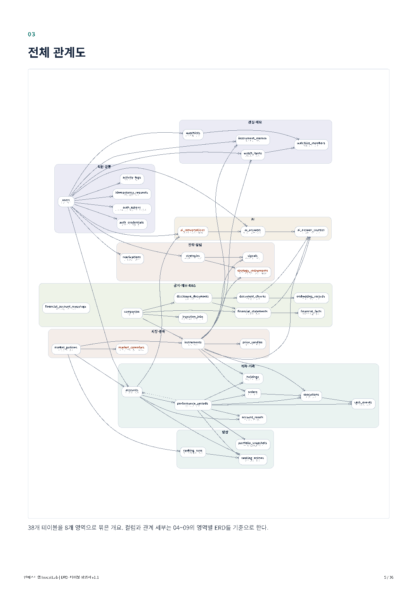
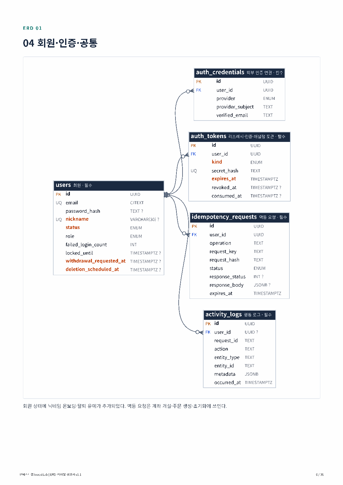
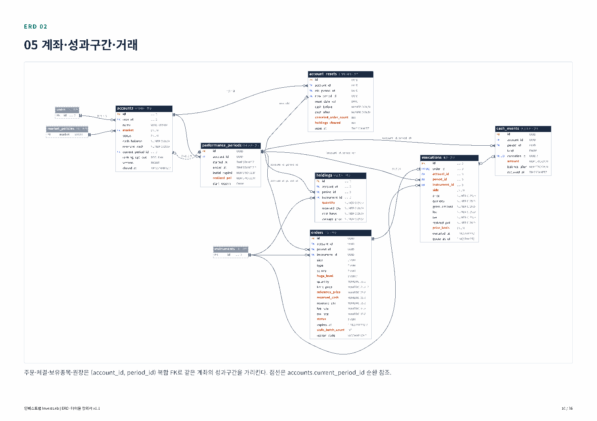
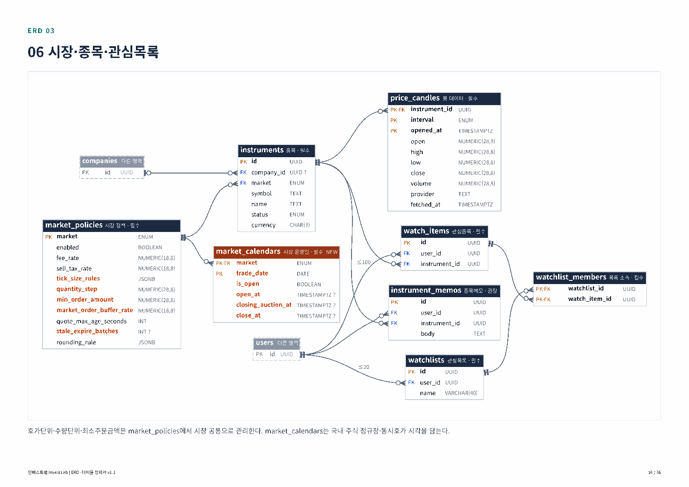
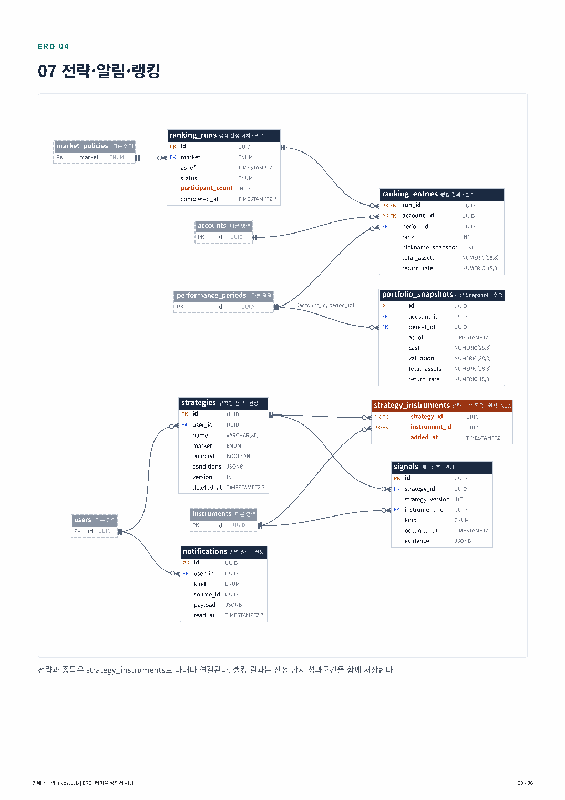
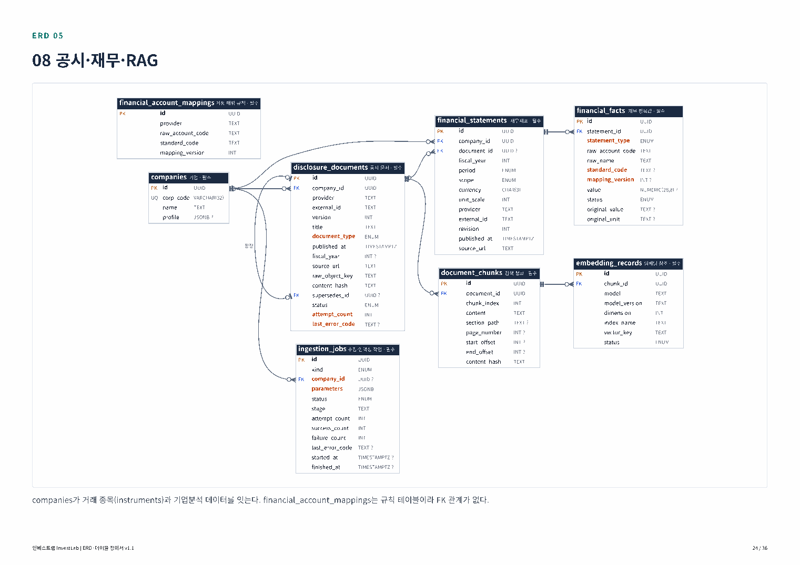
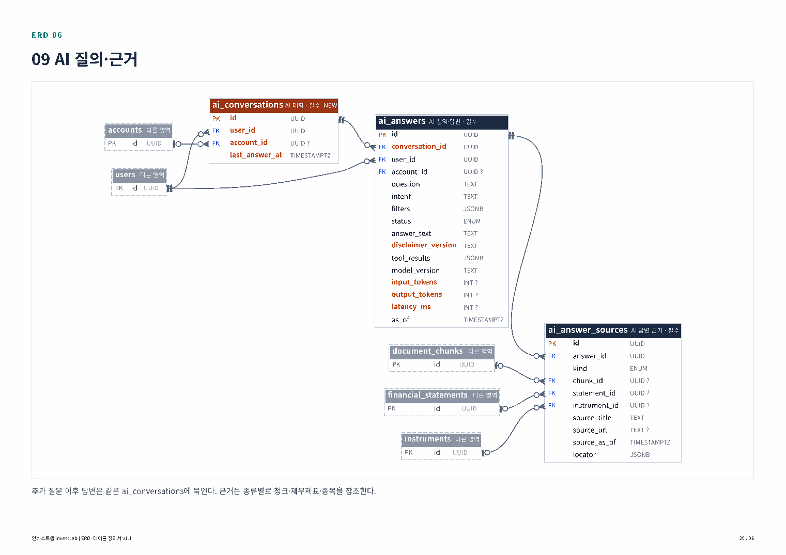

# InvestLab DB 설계서 · ERD·테이블 정의서

> 기준 원본: v1.1 · Markdown 전환일: 2026-11-24. 앞으로 이 파일을 수정 기준으로 관리한다. 전환 시 원문의 제안·미확정·필수/권장/후속 표기를 유지했으며 구현 완료를 의미하지 않는다.

원본 기록: [인베스트랩_ERD_테이블정의서_v1.1.pdf](./인베스트랩_ERD_테이블정의서_v1.1.pdf) · [문서 안내](README.md)

> 버전 주의: 기능·DB v1.1과 보관된 API v1.0은 동일 시점의 계약이 아니다. DB 원문이 참조하는 API v1.3은 현재 저장소에 없다. 정책 충돌을 임의로 해소하지 않고 원문을 보존했으며, [문서 간 차이](README.md#문서-간-차이와-적용-원칙)를 먼저 확인한다.

## 목차

- [인베스트랩](#source-page-1)
- [v1.1 변경 요약](#source-page-2)
- [계속 (3쪽)](#source-page-3)
- [공통 규약·표기법](#source-page-4)
- [전체 관계도](#source-page-5)
- [회원·인증·공통 ERD](#source-page-6)
- [users · 회원 필수](#source-page-7)
- [auth_tokens · 리프레시·인증·재설정 토큰 필수](#source-page-8)
- [activity_logs · 행동 로그 필수](#source-page-9)
- [계좌·성과구간·거래 ERD](#source-page-10)
- [accounts · 모의계좌 필수](#source-page-11)
- [account_resets · 초기화 이력 필수](#source-page-12)
- [orders · 주문 필수](#source-page-13)
- [executions · 체결 필수](#source-page-14)
- [cash_events · 현금 원장 필수](#source-page-15)
- [시장·종목·관심목록 ERD](#source-page-16)
- [market_policies · 시장 정책 필수](#source-page-17)
- [instruments · 종목 필수](#source-page-18)
- [watchlists · 관심목록 필수](#source-page-19)
- [전략·알림·랭킹 ERD](#source-page-20)
- [strategies · 규칙형 전략 권장](#source-page-21)
- [notifications · 인앱 알림 권장](#source-page-22)
- [portfolio_snapshots · 자산 Snapshot 후속](#source-page-23)
- [공시·재무·RAG ERD](#source-page-24)
- [companies · 기업 필수](#source-page-25)
- [ingestion_jobs · 수집·인덱싱 작업 필수](#source-page-26)
- [financial_facts · 재무 항목값 필수](#source-page-27)
- [document_chunks · 검색 청크 필수](#source-page-28)
- [AI 질의·근거 ERD](#source-page-29)
- [ai_conversations · AI 대화 필수 v1.1 신규](#source-page-30)
- [ai_answer_sources · AI 답변 근거 필수](#source-page-31)
- [트랜잭션 규칙](#source-page-32)
- [계산 규칙](#source-page-33)
- [인덱스·제약 요약](#source-page-34)
- [기능·API 대응](#source-page-35)
- [남은 확인 사항](#source-page-36)

<!-- 원본 PDF 1 / 36쪽 -->

### 인베스트랩

### ERD·테이블 정의서

### 논리 데이터 모델 v1.1 · 검토 결정사항 반영본

| 문서 정보 | 내용 |
| --- | --- |
| 버전 / 작성일 | v1.1 / 2026.10.10 (이전 v1.0 / 2026.09.15) |
| 연결 문서 | 기능명세서 v1.1 · API 명세서 v1.3 |
| 대상 DB | PostgreSQL — 부분 유니크 인덱스, DEFERRABLE FK, JSONB, TIMESTAMPTZ 사용 |
| 범위 | 테이블 38개 (필수 32 · 권장 5 · 후속 1) |
| v1.1 변경 | 결정사항 34건 반영 · 신규 테이블 3개(market_calendars, strategy_instruments, ai_conversations) · 신규·변경 컬럼 41개 |

읽는 순서

01 변경 요약 → 02 공통 규약·표기법 → 03 전체 관계도 → 04\~09 영역별 ERD와 테이블 정의 → 10 트랜잭션 규칙 → 11 계산 규 칙 → 12 인덱스·제약 → 13 기능·API 대응 → 14 남은 확인 사항

---

<!-- 원본 PDF 2 / 36쪽 -->

01

### v1.1 변경 요약

기능명세서 v1.1 · ERD v1.0 검토에서 확정한 결정사항과, 이를 반영한 테이블·컬럼 위치다.

| 영역 | 결정 | 반영 위치 |
| --- | --- | --- |
| 계좌 | 초기자금 1,000만원 고정(입력 없음) | accounts, performance_periods.initial_capital |
| 계좌 | 하루 계좌 개설 1개 — 해지 후 재개설 포함 | accounts 개설 검증, 인덱스 (user_id, created_at) |
| 계좌 | 해지 계좌도 이력 조회 가능(읽기 전용) | accounts.status = CLOSED |
| 계좌 | '누적 실현손익'은 현재 성과구간 기준 | performance_periods.realized_pnl |
| 계좌 | 초기화 RESET 원장은 새 성과구간 소속 | cash_events |
| 주문 | 국내 주식 장외 주문은 거부(이월 없음) | orders 접수 검증, market_calendars 신규 |
| 주문 | 동시호가 구간 시장가 주문은 당일 종가로 체결 | market_calendars.closing_auction_at, executions.price_basis |
| 주문 | 시장가 예약금 = 현재가 × 1.05 × 수량 + 수수 료 | orders.reference_price·reserved_cash, market_policies.market_order_buffer_rate |
| 주문 | 예약금은 수수료 포함 | orders.reserved_cash |
| 주문 | 장 마감 자동취소는 EXPIRED로 구분 | orders.status |
| 주문 | 가상화폐는 연속 10회(10분) 시세 없음 시 EXPIRED | orders.stale_batch_count, market_policies.stale_expire_batches |
| 체결 | 전량 매도 시 보유종목 행 삭제 | holdings (CHECK quantity > 0) |
| 체결 | 체결에 계좌·구간·종목·매수매도 비정규화 | executions |
| 시장 | 호가단위·최소주문금액은 시장 공통값 | market_policies로 이동, instruments 열 삭제 |
| 공통 | 멱등 처리는 2단계 트랜잭션 | idempotency_requests |
| 공통 | DB는 PostgreSQL | 부분 UQ, DEFERRABLE FK, JSONB, TIMESTAMPTZ |
| 랭킹 | 수익률 동률은 공동순위, 같은 순위 안은 총자산 큰 순 | ranking_entries |
| 랭킹 | 개설·초기화 당일 제외, 다음날 00:10 산정부터 참여 | 랭킹 산정 조건(accounts.ranking_eligible_after 삭제) |
| 랭킹 | 현재 구간 체결이 없는 계좌 제외 | 랭킹 산정 조건 |
| 랭킹 | 숨김 처리 후 순위를 다시 매김(1, 2, 3…) | ranking_entries 조회 규칙 |
| 개인화 | 관심목록 삭제 시 다른 목록에 없는 관심종목만 삭제 | watchlists 삭제 규칙 |
| 개인화 | 전략 하나를 여러 종목에 적용 | strategy_instruments 신규 |
| 차트 | 멀티·비교차트는 후속(2차) | 해당 테이블 없음 |
| 회원 | 비밀번호 재설정 추가 | auth_tokens.kind = PASSWORD_RESET |

---

<!-- 원본 PDF 3 / 36쪽 -->

| 영역 | 결정 | 반영 위치 |
| --- | --- | --- |
| 회원 | 탈퇴 7일 유예, 재로그인 시 취소, 재가입 시 기존 계정 즉시 삭제 | users.status·withdrawal_requested_at·deletion_scheduled_at |
| 회원 | 구글 신규가입은 닉네임 온보딩 후 이용 | users.nickname NULL 허용, PENDING_NICKNAME |
| 회원 | 구글 자동 연결은 ACTIVE 계정만 | auth_credentials 연결 규칙 |
| 재무 | ROA·ROE 분모는 기초·기말 평균 | financial_statements 규칙 |
| 재무 | 매핑 실패 계정은 standard_code NULL | financial_facts (+statement_type, mapping_version) |
| 공시 | 분기보고서를 Q1 / Q3로 구분 | disclosure_documents.document_type |
| 공시 | 여러 기업 대상 작업은 company_id NULL | ingestion_jobs.company_id |
| AI | 추가 질문 후 답변을 같은 대화로 연결 | ai_conversations 신규, ai_answers.conversation_id |
| AI | 모든 답변에 투자 권유 아님 고지 | ai_answers.disclaimer_version |
| AI | 1차 질의 한도 없음, 비용은 모니터링 | ai_answers.input_tokens·output_tokens·latency_ms |

v1.0 대비 삭제된 열

instruments.price_step_rules · quantity_step · min_amount → market_policies로 이동 accounts.ranking_eligible_after → 성과구간 시작시각으로 랭킹 참여 판단

---

<!-- 원본 PDF 4 / 36쪽 -->

02

### 공통 규약·표기법

| 항목 | 규칙 |
| --- | --- |
| ID | UUID. 인덱스 효율을 위해 시간순 UUID(UUIDv7) 생성을 권장한다. |
| 시각 | TIMESTAMPTZ(UTC 저장). 날짜 경계·초기화 일자·랭킹 기준일은 Asia/Seoul(KST). API는 시간대가 포함 된 ISO 8601. |
| 금액·가격·수량 | NUMERIC(28,8). 비율은 NUMERIC(18,8). API에서는 소수값을 문자열로 반환한다. |
| JSON | JSONB. 구조가 검증된 값만 저장한다. |
| 열거형 | PostgreSQL ENUM 타입 또는 CHECK 제약. 값은 API 명세서 v1.3과 같다. |
| 공통 열 | 모든 테이블에 created_at, 변경 가능한 테이블에 updated_at. 아래 테이블 정의에서는 생략한다. |
| 시장 코드 | KR_STOCK / CRYPTO_KRW. 거래 현금은 KRW. |

ERD 표기

부모 선택 FK(NULL 허용) 자식 남색 헤더 기존 테이블, 주황 헤더 v1.1 신규 테이블 주황 글씨 컬럼 v1.1에서 추가·변경된 컬럼 1 : 0..1 부모 자식 회색 점선 상자 다른 영역 테이블(관계 확인용으로 PK만 표시) 1 : 0..N 타입 뒤 ? = NULL 허용 · 키 표기 PK / FK / UQ 부모 자식 점선 관계 = 순환 참조(accounts.current_period_id) 관계 라벨 (account_id, period_id) = 복합 FK

---

<!-- 원본 PDF 5 / 36쪽 -->

## 전체 관계도

관계선과 복합 FK 주석을 보존한 원본 도면이다. 편집 가능한 필드·관계·제약은 뒤의 테이블 정의와 트랜잭션 규칙에 명시한다.

---

<!-- 원본 PDF 6 / 36쪽 -->

## 회원·인증·공통 ERD

관계선과 복합 FK 주석을 보존한 원본 도면이다. 편집 가능한 필드·관계·제약은 뒤의 테이블 정의와 트랜잭션 규칙에 명시한다.

---

<!-- 원본 PDF 7 / 36쪽 -->

04 · 테이블 정의

### users · 회원 필수

| 필드 | 타입 | 키 | 널 | 설명 |
| --- | --- | --- | --- | --- |
| id | UUID | PK | NN | 회원 ID |
| email | CITEXT | UQ | NN | 정규화된 이메일(대소문자 무시) |
| password_hash | TEXT |  | NULL | 구글 전용 계정은 NULL |
| nickname | VARCHAR(30) | UQ | NULL | 구글 신규가입은 온보딩 완료 전까지 NULL |
| status | ENUM |  | NN | PENDING_EMAIL / PENDING_NICKNAME / ACTIVE / WITHDRAWAL_PENDING |
| role | ENUM |  | NN | USER / ADMIN |
| failed_login_count | INT |  | NN | 연속 비밀번호 실패 횟수, 기본 0 |
| locked_until | TIMESTAMPTZ |  | NULL | 로그인 제한 종료시각(5회 실패 시 +10분) |
| withdrawal_requested_at | TIMESTAMPTZ |  | NULL | 탈퇴 요청시각 |
| deletion_scheduled_at | TIMESTAMPTZ |  | NULL | 탈퇴 요청 + 7일. 이 시각 이후 배치가 완전삭제 |

CHECK: status = ACTIVE 이면 nickname IS NOT NULL. 닉네임 설정 전(PENDING_NICKNAME)에는 계좌·주문 API를 차단한다. 탈퇴 유예기간 중 재로그인하면 status를 ACTIVE로 되돌리고 탈퇴 관련 두 시각을 NULL로 비운다. 같은 이메일로 재가입하면 유예 중인 기존 계정을 즉시 완전삭제(복구 불가)한 뒤 새 계정을 만든다. 이메일 UQ는 그대로 유지된다.

### auth_credentials · 외부 인증 연결 필수

| 필드 | 타입 | 키 | 널 | 설명 |
| --- | --- | --- | --- | --- |
| id | UUID | PK | NN | 인증 연결 ID |
| user_id | UUID | FK | NN | users.id |
| provider | ENUM |  | NN | GOOGLE |
| provider_subject | TEXT |  | NN | 구글이 검증한 사용자 식별값(sub) |
| verified_email | TEXT |  | NN | 구글이 검증한 이메일 |

UQ(provider, provider_subject). 자동 연결은 같은 이메일의 기존 계정이 ACTIVE(이메일 인증 완료)일 때만 한다. 기존 계정이 PENDING_EMAIL이면 연결하지 않는다. 미인증 계정은 로그인할 수 없어 계좌·거래 데이터가 없으므로 폐기하고, 구글 인증 결과 로 새 계정을 만든다(PENDING_NICKNAME).

---

<!-- 원본 PDF 8 / 36쪽 -->

### auth_tokens · 리프레시·인증·재설정 토큰 필수

| 필드 | 타입 | 키 | 널 | 설명 |
| --- | --- | --- | --- | --- |
| id | UUID | PK | NN | 토큰 레코드 ID |
| user_id | UUID | FK | NN | users.id |
| kind | ENUM |  | NN | REFRESH / EMAIL_VERIFY / PASSWORD_RESET |
| secret_hash | TEXT | UQ | NN | 원문 토큰 대신 해시 저장 |
| expires_at | TIMESTAMPTZ |  | NN | REFRESH 14일, EMAIL_VERIFY·PASSWORD_RESET 24시간 |
| revoked_at | TIMESTAMPTZ |  | NULL | 로그아웃·재발급·비밀번호 변경 시 무효화 |
| consumed_at | TIMESTAMPTZ |  | NULL | 일회용 토큰 사용시각 |

EMAIL_VERIFY·PASSWORD_RESET 재발송은 회원별 마지막 발급시각 기준 1분 1회로 제한한다. 비밀번호 재설정이 완료되면 해당 회원의 REFRESH 토큰을 모두 revoke한다.

### idempotency_requests · 멱등 요청 필수

| 필드 | 타입 | 키 | 널 | 설명 |
| --- | --- | --- | --- | --- |
| id | UUID | PK | NN | 요청 기록 ID |
| user_id | UUID | FK | NN | 인증 사용자 |
| operation | TEXT |  | NN | ACCOUNT_CREATE / ORDER_CREATE / ACCOUNT_RESET |
| request_key | TEXT |  | NN | Idempotency-Key 헤더 값 |
| request_hash | TEXT |  | NN | 경로·본문 해시 |
| status | ENUM |  | NN | PROCESSING / COMPLETED |
| response_status | INT |  | NULL | 저장된 HTTP 상태 |
| response_body | JSONB |  | NULL | 저장된 응답(재요청 시 그대로 반환) |
| expires_at | TIMESTAMPTZ |  | NN | 생성 + 24시간 후 정리 |

UQ(user_id, operation, request_key). 2단계 처리: ① PROCESSING 행을 별도 짧은 트랜잭션으로 먼저 커밋 → ② 업무 트랜잭션 안에서 업무 변경과 함께 COMPLETED·응답을 저 장. 업무 실패 시 업무 트랜잭션을 롤백하고 PROCESSING 행을 삭제해 같은 키로 재시도할 수 있게 한다. 같은 키가 PROCESSING이면 409 REQUEST_IN_PROGRESS, 같은 키·다른 본문이면 409 IDEMPOTENCY_KEY_CONFLICT. 서버 비정상 종료로 PROCESSING이 남는 경우를 위해 일정 시간(예: 5분) 지난 PROCESSING 행은 정리 대상으로 본다.

---

<!-- 원본 PDF 9 / 36쪽 -->

### activity_logs · 행동 로그 필수

| 필드 | 타입 | 키 | 널 | 설명 |
| --- | --- | --- | --- | --- |
| id | UUID | PK | NN | 이벤트 ID |
| user_id | UUID | FK | NULL | 시스템 배치·탈퇴 완료 회원은 NULL |
| request_id | TEXT |  | NN | API·배치 상관관계 ID |
| action | TEXT |  | NN | 동작 |
| entity_type | TEXT |  | NN | 대상 종류 |
| entity_id | TEXT |  | NN | 대상 ID |
| metadata | JSONB |  | NN | 민감정보를 제거한 변경 요약 |
| occurred_at | TIMESTAMPTZ |  | NN | 발생시각 |

비밀번호·토큰은 저장하지 않는다. 핵심 성공 이벤트는 업무 트랜잭션과 함께 저장한다. 회원 완전삭제 시 user_id를 NULL로 바꿔 익명 로그로만 남긴다.

---

<!-- 원본 PDF 10 / 36쪽 -->

## 계좌·성과구간·거래 ERD

관계선과 복합 FK 주석을 보존한 원본 도면이다. 편집 가능한 필드·관계·제약은 뒤의 테이블 정의와 트랜잭션 규칙에 명시한다.

---

<!-- 원본 PDF 11 / 36쪽 -->

05 · 테이블 정의

### accounts · 모의계좌 필수

| 필드 | 타입 | 키 | 널 | 설명 |
| --- | --- | --- | --- | --- |
| id | UUID | PK | NN | 계좌 ID |
| user_id | UUID | FK | NN | users.id |
| name | VARCHAR(40) |  | NN | 계좌명 |
| market | ENUM | FK | NN | market_policies.market (KR_STOCK / CRYPTO_KRW) |
| status | ENUM |  | NN | ACTIVE / CLOSED |
| cash_balance | NUMERIC(28,8) |  | NN | 현재 현금, 0 이상 |
| reserved_cash | NUMERIC(28,8) |  | NN | 매수 예약금 합계, 0 이상·현금 이하 |
| current_period_id | UUID | FK | NN | 현재 performance_periods.id (DEFERRABLE) |
| ranking_opt_out | BOOLEAN |  | NN | 랭킹 노출 제외, 기본 false |
| version | BIGINT |  | NN | 낙관적 잠금용 버전 |
| closed_at | TIMESTAMPTZ |  | NULL | 해지시각 |

개설은 사용자 행 잠금 아래에서 ① 활성 계좌 3개 이하 ② 같은 KST 날짜에 개설한 계좌 0개(해지 후 재개설 포함)를 함께 검증한다. 하루 1개 제한. 초기자금은 1,000만원 고정. 입력값으로 받지 않는다. 해지 계좌(CLOSED)도 목록·상세·주문·체결 조회가 가능하다. 주문·초기화 등 변경은 거부한다. v1.0의 ranking_eligible_after 열은 삭제. 랭킹 참여 시점은 성과구간 시작시각으로 판단한다(ranking_entries 참고).

### performance_periods · 성과구간 필수

| 필드 | 타입 | 키 | 널 | 설명 |
| --- | --- | --- | --- | --- |
| id | UUID | PK | NN | 성과구간 ID |
| account_id | UUID | FK | NN | accounts.id |
| started_at | TIMESTAMPTZ |  | NN | 개설 또는 초기화 시각 |
| ended_at | TIMESTAMPTZ |  | NULL | 현재 구간은 NULL |
| initial_capital | NUMERIC(28,8) |  | NN | 10,000,000 KRW |
| realized_pnl | NUMERIC(28,8) |  | NN | 구간 누적 실현손익. 화면의 '누적 실현손익'은 이 값 |
| start_reason | ENUM |  | NN | OPEN / RESET |

부분 UQ(account_id) WHERE ended_at IS NULL — 계좌당 열린 구간 1개(PostgreSQL 부분 인덱스). UQ(account_id, id) — 주문·체결·포지션·원장의 복합 FK 대상. accounts.current_period_id와 순환 참조이므로 FK를 DEFERRABLE INITIALLY DEFERRED로 만들고 같은 트랜잭션에서 함께 생성한다.

---

<!-- 원본 PDF 12 / 36쪽 -->

### account_resets · 초기화 이력 필수

| 필드 | 타입 | 키 | 널 | 설명 |
| --- | --- | --- | --- | --- |
| id | UUID | PK | NN | 초기화 ID |
| account_id | UUID | FK | NN | accounts.id |
| old_period_id | UUID | FK | NN | 종료된 성과구간 |
| new_period_id | UUID | FK | NN | 새 성과구간 |
| reset_date_kst | DATE |  | NN | KST 실행일 |
| cash_before | NUMERIC(28,8) |  | NN | 초기화 전 현금 |
| cash_after | NUMERIC(28,8) |  | NN | 초기화 후 현금(10,000,000) |
| canceled_order_count | INT |  | NN | 함께 취소된 미체결 주문 수 |
| holdings_cleared | INT |  | NN | 제거된 보유종목 수(API 응답값) |
| reset_at | TIMESTAMPTZ |  | NN | 실행시각 |

UQ(account_id, reset_date_kst) — 계좌당 KST 하루 1회. 보유종목은 매도 체결 없이 제거한다. 초기화 전 보유 내역은 이전 체결로 조회한다.

---

<!-- 원본 PDF 13 / 36쪽 -->

### orders · 주문 필수

| 필드 | 타입 | 키 | 널 | 설명 |
| --- | --- | --- | --- | --- |
| id | UUID | PK | NN | 주문 ID |
| account_id | UUID | FK | NN | 복합 FK (account_id, period_id) |
| period_id | UUID | FK | NN | → performance_periods(account_id, id) |
| instrument_id | UUID | FK | NN | instruments.id |
| side | ENUM |  | NN | BUY / SELL |
| type | ENUM |  | NN | MARKET / LIMIT |
| source | ENUM |  | NN | FORM / ORDERBOOK (API의 HOGA = LIMIT + ORDERBOOK) |
| hoga_level | ENUM |  | NULL | ASK_1 / BID_1, ORDERBOOK일 때만 |
| quantity | NUMERIC(28,8) |  | NN | 0 초과, 시장 수량단위 검증 |
| limit_price | NUMERIC(28,8) |  | NULL | LIMIT일 때 필수, 0 초과 |
| reference_price | NUMERIC(28,8) |  | NN | 예약 산정 기준가. 시장가는 접수시점 캐시 현재가 |
| reserved_cash | NUMERIC(28,8) |  | NN | 매수 예약금(수수료 포함, 시장가는 5% 버퍼) |
| reserved_qty | NUMERIC(28,8) |  | NN | 매도 예약수량, 매수는 0 |
| fee_rate | NUMERIC(18,8) |  | NN | 접수 당시 수수료율 |
| tax_rate | NUMERIC(18,8) |  | NN | 접수 당시 매도 세율 |
| status | ENUM |  | NN | PENDING / FILLED / CANCELED / EXPIRED / REJECTED |
| expires_at | TIMESTAMPTZ |  | NULL | 국내 주식은 당일 장 마감, 가상화폐 NULL |
| stale_batch_count | INT |  | NN | 유효 시세 없이 넘어간 연속 배치 수, 기본 0 |
| reason_code | VARCHAR(60) |  | NULL | 취소·만료·거부·체결보류 사유 |

접수 검증: 계좌 market = 종목 market. 국내 주식은 market_calendars 기준 정규장 시간 외 접수를 거부한다 (AFTER_HOURS_ORDER_REJECTED, 이월 없음). 가상화폐는 24시간 접수. 상태 구분: CANCELED = 사용자 취소, EXPIRED = 시스템 자동 만료(국내 주식 장 마감 / 가상화폐 연속 10회 시세 없음), REJECTED = 체결 직전 재검증 실패(잔액 부족 등). 체결 보류는 PENDING을 유지하고 stale_batch_count를 1 올린다. 정상 시세로 평가되면 0으로 되돌린다.

---

<!-- 원본 PDF 14 / 36쪽 -->

### executions · 체결 필수

| 필드 | 타입 | 키 | 널 | 설명 |
| --- | --- | --- | --- | --- |
| id | UUID | PK | NN | 체결 ID |
| order_id | UUID | FK·UQ | NN | orders.id, 주문당 최대 1회(전량 체결) |
| account_id | UUID | FK | NN | 비정규화 — orders 값 복사 |
| period_id | UUID | FK | NN | 비정규화 — 복합 FK (account_id, period_id) |
| instrument_id | UUID | FK | NN | 비정규화 — orders 값 복사 |
| side | ENUM |  | NN | 비정규화 — BUY / SELL |
| price | NUMERIC(28,8) |  | NN | 체결가 |
| quantity | NUMERIC(28,8) |  | NN | 체결수량(= 주문수량) |
| gross_amount | NUMERIC(28,8) |  | NN | 가격 × 수량 |
| fee | NUMERIC(28,8) |  | NN | 실제 수수료 |
| tax | NUMERIC(28,8) |  | NN | 실제 세금, 매수는 0 |
| realized_pnl | NUMERIC(28,8) |  | NN | 매도 확정 손익, 매수는 0 |
| price_basis | ENUM |  | NN | LAST(최신가) / CLOSING(동시호가 종가) |
| executed_at | TIMESTAMPTZ |  | NN | 체결시각 |
| quote_as_of | TIMESTAMPTZ |  | NN | 사용한 가격의 시세시각 |

비정규화한 4개 열은 체결 트랜잭션에서 orders 값을 그대로 복사하며, 트리거 또는 서비스 검증으로 orders와 일치를 보장한다. 인덱스 (account_id, executed_at), (account_id, instrument_id, executed_at) — TRADE-03 기간·종목·매수매도 필터를 orders 조인 없이 처리.

### holdings · 보유종목 필수

| 필드 | 타입 | 키 | 널 | 설명 |
| --- | --- | --- | --- | --- |
| id | UUID | PK | NN | 포지션 ID |
| account_id | UUID | FK | NN | 복합 FK (account_id, period_id) |
| period_id | UUID | FK | NN | 현재 성과구간 |
| instrument_id | UUID | FK | NN | instruments.id |
| quantity | NUMERIC(28,8) |  | NN | 보유수량, CHECK > 0 |
| reserved_qty | NUMERIC(28,8) |  | NN | 매도 예약수량, 0 ≤ reserved_qty ≤ quantity |
| cost_basis | NUMERIC(28,8) |  | NN | 매수 수수료 포함 취득원가 |
| average_price | NUMERIC(28,8) |  | NN | cost_basis ÷ quantity |

UQ(period_id, instrument_id). 전량 매도 체결 시 행을 삭제한다(수량 0 행을 남기지 않음 → 평균매입가 0 나눗셈 없음). 초기화 시에도 구간의 모든 행을 삭제한다.

---

<!-- 원본 PDF 15 / 36쪽 -->

### cash_events · 현금 원장 필수

| 필드 | 타입 | 키 | 널 | 설명 |
| --- | --- | --- | --- | --- |
| id | UUID | PK | NN | 원장 ID |
| account_id | UUID | FK | NN | 복합 FK (account_id, period_id) |
| period_id | UUID | FK | NN | 소속 성과구간 |
| kind | ENUM |  | NN | OPEN / BUY / SELL / RESET |
| execution_id | UUID | FK·UQ | NULL | BUY·SELL이면 필수, OPEN·RESET은 NULL |
| amount | NUMERIC(28,8) |  | NN | BUY = −(체결금액+수수료), SELL = 체결금액−수수료−세금 |
| balance_after | NUMERIC(28,8) |  | NN | 변동 직후 현금 |
| occurred_at | TIMESTAMPTZ |  | NN | 변동시각 |

RESET 행은 새 성과구간(new_period_id)에 기록한다. amount = 10,000,000 − 직전 현금. OPEN과 같은 '구간 개시 기록' 역할. 예약·예약 해제는 현금 변동이 아니므로 원장에 남기지 않는다. 검증: 계좌의 전체 원장 amount 합 = accounts.cash_balance.

---

<!-- 원본 PDF 16 / 36쪽 -->

## 시장·종목·관심목록 ERD

관계선과 복합 FK 주석을 보존한 원본 도면이다. 편집 가능한 필드·관계·제약은 뒤의 테이블 정의와 트랜잭션 규칙에 명시한다.

---

<!-- 원본 PDF 17 / 36쪽 -->

06 · 테이블 정의

### market_policies · 시장 정책 필수

| 필드 | 타입 | 키 | 널 | 설명 |
| --- | --- | --- | --- | --- |
| market | ENUM | PK | NN | KR_STOCK / CRYPTO_KRW |
| enabled | BOOLEAN |  | NN | 정책·데이터 준비 완료 시 true |
| fee_rate | NUMERIC(18,8) |  | NN | 수수료율 |
| sell_tax_rate | NUMERIC(18,8) |  | NN | 매도 세율 |
| tick_size_rules | JSONB |  | NN | 가격대별 공통 호가단위 표(시장 공통) |
| quantity_step | NUMERIC(28,8) |  | NN | 수량 단위(주식 1, 가상화폐 소수 정밀도) |
| min_order_amount | NUMERIC(28,8) |  | NN | 최소 주문금액(시장 공통) |
| market_order_buffer_rate | NUMERIC(18,8) |  | NN | 시장가 매수 예약 버퍼, 기본 0.05(5%) |
| quote_max_age_seconds | INT |  | NN | 체결에 쓸 수 있는 시세 최대 경과시간 |
| stale_expire_batches | INT |  | NULL | 연속 시세 없음 자동만료 기준. CRYPTO_KRW = 10, KR_STOCK = NULL |
| rounding_rule | JSONB |  | NN | 금액·수수료·세금 반올림 기준 |

호가단위·수량단위·최소주문금액은 종목별이 아니라 시장 공통값으로 둔다(P-03 확정, v1.0 instruments 열에서 이동). 정책 변경은 새 주문부터 적용한다. 수수료·세율은 접수 시 orders에 복사한다.

### market_calendars · 시장 운영일 필수 v1.1 신규

| 필드 | 타입 | 키 | 널 | 설명 |
| --- | --- | --- | --- | --- |
| market | ENUM | PK·FK | NN | market_policies.market |
| trade_date | DATE | PK | NN | KST 거래일 |
| is_open | BOOLEAN |  | NN | 휴장일 false |
| open_at | TIMESTAMPTZ |  | NULL | 정규장 시작 |
| closing_auction_at | TIMESTAMPTZ |  | NULL | 장 마감 동시호가 시작 |
| close_at | TIMESTAMPTZ |  | NULL | 정규장 마감 |

국내 주식 전용. 가상화폐는 행을 두지 않으며 24시간 운영으로 본다. 정규장(open_at\~close_at) 밖의 주식 주문은 접수를 거부한다. closing_auction_at\~close_at 사이 접수된 시장가 주문은 장 마감 후 첫 배치에서 당일 종가로 체결한다(executions.price_basis = CLOSING).

---

<!-- 원본 PDF 18 / 36쪽 -->

### instruments · 종목 필수

| 필드 | 타입 | 키 | 널 | 설명 |
| --- | --- | --- | --- | --- |
| id | UUID | PK | NN | 종목 ID |
| company_id | UUID | FK | NULL | 주식이면 companies.id, 가상화폐 NULL |
| market | ENUM | FK | NN | market_policies.market |
| symbol | TEXT |  | NN | 외부 종목코드 |
| name | TEXT |  | NN | 종목명 |
| status | ENUM |  | NN | TRADABLE / HALTED / DELISTED |
| currency | CHAR(3) |  | NN | KRW |

UQ(market, symbol). v1.0의 price_step_rules·quantity_step·min_amount 열은 삭제하고 market_policies로 옮겼다.

### price_candles · 봉 데이터 필수

| 필드 | 타입 | 키 | 널 | 설명 |
| --- | --- | --- | --- | --- |
| instrument_id | UUID | PK·FK | NN | instruments.id |
| interval | ENUM | PK | NN | DAY / WEEK / MONTH (분봉은 권장) |
| opened_at | TIMESTAMPTZ | PK | NN | 봉 시작시각 |
| open | NUMERIC(28,8) |  | NN | 시가 |
| high | NUMERIC(28,8) |  | NN | 고가 |
| low | NUMERIC(28,8) |  | NN | 저가 |
| close | NUMERIC(28,8) |  | NN | 종가 |
| volume | NUMERIC(28,8) |  | NN | 거래량 |
| provider | TEXT |  | NN | 공급자 |
| fetched_at | TIMESTAMPTZ |  | NN | 수집시각 |

현재가·최우선 호가는 Redis 캐시(price:*, orderbook:*)에 두고 영구 테이블을 만들지 않는다.

### watch_items · 관심종목 필수

| 필드 | 타입 | 키 | 널 | 설명 |
| --- | --- | --- | --- | --- |
| id | UUID | PK | NN | 관심종목 ID |
| user_id | UUID | FK | NN | users.id |
| instrument_id | UUID | FK | NN | instruments.id |

UQ(user_id, instrument_id). 사용자당 최대 100개, 사용자 행 잠금 아래 검사.

---

<!-- 원본 PDF 19 / 36쪽 -->

### watchlists · 관심목록 필수

| 필드 | 타입 | 키 | 널 | 설명 |
| --- | --- | --- | --- | --- |
| id | UUID | PK | NN | 목록 ID |
| user_id | UUID | FK | NN | users.id |
| name | VARCHAR(40) |  | NN | 목록명 |

사용자당 최대 20개. 목록 삭제 규칙: ① watchlist_members의 해당 목록 행 삭제 → ② 그 목록에 있던 관심종목 중 다른 목록 소속이 남지 않은 watch_items만 삭제. 다른 목록에도 있는 관심종목은 유지한다. 한 트랜잭션에서 처리.

### watchlist_members · 목록 소속 필수

| 필드 | 타입 | 키 | 널 | 설명 |
| --- | --- | --- | --- | --- |
| watchlist_id | UUID | PK·FK | NN | watchlists.id (ON DELETE CASCADE) |
| watch_item_id | UUID | PK·FK | NN | watch_items.id (ON DELETE CASCADE) |

복합 PK. 목록과 관심종목의 user_id가 같아야 한다(서버 검증). 같은 관심종목이 여러 목록에 속할 수 있다.

### instrument_memos · 종목메모 권장

| 필드 | 타입 | 키 | 널 | 설명 |
| --- | --- | --- | --- | --- |
| id | UUID | PK | NN | 메모 ID |
| user_id | UUID | FK | NN | users.id |
| instrument_id | UUID | FK | NN | instruments.id |
| body | TEXT |  | NN | 1\~10,000자 |

개수 제한 없음. 인덱스 (user_id, instrument_id, created_at DESC).

---

<!-- 원본 PDF 20 / 36쪽 -->

## 전략·알림·랭킹 ERD

관계선과 복합 FK 주석을 보존한 원본 도면이다. 편집 가능한 필드·관계·제약은 뒤의 테이블 정의와 트랜잭션 규칙에 명시한다.

---

<!-- 원본 PDF 21 / 36쪽 -->

07 · 테이블 정의

### strategies · 규칙형 전략 권장

| 필드 | 타입 | 키 | 널 | 설명 |
| --- | --- | --- | --- | --- |
| id | UUID | PK | NN | 전략 ID |
| user_id | UUID | FK | NN | users.id |
| name | VARCHAR(80) |  | NN | 전략명 |
| market | ENUM |  | NN | 대상 시장 |
| enabled | BOOLEAN |  | NN | 활성 여부 |
| conditions | JSONB |  | NN | 이동평균 교차 조건(실행 코드 금지) |
| version | INT |  | NN | 조건 수정 버전 |
| deleted_at | TIMESTAMPTZ |  | NULL | 소프트 삭제 |

대상 종목은 strategy_instruments로 연결한다(다대다).

### strategy_instruments · 전략 대상 종목 권장 v1.1 신규

| 필드 | 타입 | 키 | 널 | 설명 |
| --- | --- | --- | --- | --- |
| strategy_id | UUID | PK·FK | NN | strategies.id |
| instrument_id | UUID | PK·FK | NN | instruments.id |
| added_at | TIMESTAMPTZ |  | NN | 연결시각 |

복합 PK. 종목 market = 전략 market. 전략 수정(PATCH)에서 instrumentIds를 받으면 연결 전체를 교체한다. 신호 생성은 현재 연결된 종목만 평가한다.

### signals · 매매신호 권장

| 필드 | 타입 | 키 | 널 | 설명 |
| --- | --- | --- | --- | --- |
| id | UUID | PK | NN | 신호 ID |
| strategy_id | UUID | FK | NN | strategies.id |
| strategy_version | INT |  | NN | 발생 당시 조건 버전 |
| instrument_id | UUID | FK | NN | instruments.id |
| kind | ENUM |  | NN | GOLDEN_CROSS / DEAD_CROSS |
| occurred_at | TIMESTAMPTZ |  | NN | 평가 봉 기준시각 |
| evidence | JSONB |  | NN | 단기·장기 이동평균 값 |

UQ(strategy_id, strategy_version, instrument_id, kind, occurred_at). 종목 연결이 해제돼도 과거 신호는 보존한다(strategies·instruments를 각각 참조).

---

<!-- 원본 PDF 22 / 36쪽 -->

### notifications · 인앱 알림 권장

| 필드 | 타입 | 키 | 널 | 설명 |
| --- | --- | --- | --- | --- |
| id | UUID | PK | NN | 알림 ID |
| user_id | UUID | FK | NN | users.id |
| kind | ENUM |  | NN | SIGNAL(권장) / DISCLOSURE(후속) |
| source_id | UUID |  | NN | 신호·공시 ID(다형 참조, FK 아님) |
| payload | JSONB |  | NN | 제목·요약·이동 대상 |
| read_at | TIMESTAMPTZ |  | NULL | 읽음 시각 |

UQ(user_id, kind, source_id). source_id는 kind별로 서버에서 존재를 확인한다.

### ranking_runs · 랭킹 산정 회차 필수

| 필드 | 타입 | 키 | 널 | 설명 |
| --- | --- | --- | --- | --- |
| id | UUID | PK | NN | 회차 ID |
| market | ENUM | FK | NN | market_policies.market |
| as_of | TIMESTAMPTZ |  | NN | 공통 평가 기준시각(매일 00:10 KST) |
| status | ENUM |  | NN | RUNNING / COMPLETED / FAILED |
| participant_count | INT |  | NULL | 산정 대상 계좌 수 |
| completed_at | TIMESTAMPTZ |  | NULL | 완료시각 |

UQ(market, as_of). 완료된 최신 회차만 공개한다.

### ranking_entries · 랭킹 결과 필수

| 필드 | 타입 | 키 | 널 | 설명 |
| --- | --- | --- | --- | --- |
| run_id | UUID | PK·FK | NN | ranking_runs.id |
| account_id | UUID | PK·FK | NN | accounts.id |
| period_id | UUID | FK | NN | 산정 당시 성과구간 |
| rank | INT |  | NN | 산정 시점 순위(수익률 동률은 공동순위) |
| nickname_snapshot | TEXT |  | NN | 산정 시 닉네임 |
| total_assets | NUMERIC(28,8) |  | NN | 평가 총자산 |
| return_rate | NUMERIC(18,8) |  | NN | 구간 수익률 |

산정 대상: ACTIVE 계좌 · ranking_opt_out = false · 현재 구간 시작시각 < as_of의 KST 날짜 0시(개설·초기화 당일 제외, 다음날 00:10 배 치부터 참여) · 현재 구간에 체결 1건 이상(미체결 계좌 제외). 정렬: return_rate DESC → total_assets DESC. rank = RANK() OVER (ORDER BY return_rate DESC) — 수익률이 같으면 공동순위, 같 은 순위 안에서는 총자산이 큰 계좌를 먼저 표시. 조회 시: 산정 이후 옵트아웃·해지·초기화된 계좌를 숨기고, 남은 행으로 RANK()를 다시 계산해 1, 2, 3…으로 재번호한다.

---

<!-- 원본 PDF 23 / 36쪽 -->

### portfolio_snapshots · 자산 Snapshot 후속

| 필드 | 타입 | 키 | 널 | 설명 |
| --- | --- | --- | --- | --- |
| id | UUID | PK | NN | Snapshot ID |
| account_id | UUID | FK | NN | 복합 FK (account_id, period_id) |
| period_id | UUID | FK | NN | 성과구간 |
| as_of | TIMESTAMPTZ |  | NN | 평가 기준시각 |
| cash | NUMERIC(28,8) |  | NN | 현금 |
| valuation | NUMERIC(28,8) |  | NN | 보유 평가액 |
| total_assets | NUMERIC(28,8) |  | NN | 총자산 |
| return_rate | NUMERIC(18,8) |  | NN | 구간 수익률 |

UQ(account_id, as_of). 차트는 성과구간별로 끊어서 표시한다.

---

<!-- 원본 PDF 24 / 36쪽 -->

## 공시·재무·RAG ERD

관계선과 복합 FK 주석을 보존한 원본 도면이다. 편집 가능한 필드·관계·제약은 뒤의 테이블 정의와 트랜잭션 규칙에 명시한다.

---

<!-- 원본 PDF 25 / 36쪽 -->

08 · 테이블 정의

### companies · 기업 필수

| 필드 | 타입 | 키 | 널 | 설명 |
| --- | --- | --- | --- | --- |
| id | UUID | PK | NN | 기업 ID |
| corp_code | VARCHAR(32) | UQ | NN | 공시 공급자 기업코드 |
| name | TEXT |  | NN | 기업명 |
| profile | JSONB |  | NULL | 업종·기본정보 |

instruments.company_id로 거래 종목과 연결된다. 거래 영역과 기업분석 영역을 잇는 기준 테이블.

### disclosure_documents · 공시 문서 필수

| 필드 | 타입 | 키 | 널 | 설명 |
| --- | --- | --- | --- | --- |
| id | UUID | PK | NN | 공시 문서 ID |
| company_id | UUID | FK | NN | companies.id |
| provider | TEXT |  | NN | 공급자 |
| external_id | TEXT |  | NN | 공급자 문서 ID |
| version | INT |  | NN | 문서 버전 |
| title | TEXT |  | NN | 제목 |
| document_type | ENUM |  | NN | ANNUAL / HALF / Q1 / Q3 / MAJOR |
| published_at | TIMESTAMPTZ |  | NN | 공시시각 |
| fiscal_year | INT |  | NULL | 대상 사업연도 |
| source_url | TEXT |  | NN | 사용자에게 보여줄 출처 링크 |
| raw_object_key | TEXT |  | NN | 원문 저장 위치 |
| content_hash | TEXT |  | NN | 내용 변경 탐지 |
| supersedes_id | UUID | FK | NULL | 정정 전 문서 |
| status | ENUM |  | NN | COLLECTED / READY / FAILED |
| attempt_count | INT |  | NN | 문서 단위 처리 재시도 횟수 |
| last_error_code | TEXT |  | NULL | 마지막 실패 코드 |

UQ(provider, external_id, version). 분기보고서를 Q1/Q3로 나눠 RAG 기간 필터가 분기까지 구분되게 한다. 공시 본문은 분석 데이터로만 다루며, 본문 안 문장으로 시스템 동작을 바꾸지 않는다.

---

<!-- 원본 PDF 26 / 36쪽 -->

### ingestion_jobs · 수집·인덱싱 작업 필수

| 필드 | 타입 | 키 | 널 | 설명 |
| --- | --- | --- | --- | --- |
| id | UUID | PK | NN | 작업 ID |
| kind | ENUM |  | NN | DISCLOSURE / FINANCIAL / REINDEX |
| company_id | UUID | FK | NULL | 단일 기업 작업. 여러 기업·전체 작업은 NULL |
| parameters | JSONB |  | NN | 기간·연도·공시유형·대상 기업 목록 |
| status | ENUM |  | NN | QUEUED / RUNNING / COMPLETED / FAILED |
| stage | TEXT |  | NN | 현재 단계 |
| attempt_count | INT |  | NN | 재시도 횟수 |
| success_count | INT |  | NN | 성공 건수 |
| failure_count | INT |  | NN | 실패 건수 |
| last_error_code | TEXT |  | NULL | 마지막 실패 코드 |
| started_at | TIMESTAMPTZ |  | NULL | 시작시각 |
| finished_at | TIMESTAMPTZ |  | NULL | 종료시각 |

company_id가 NULL이면 parameters.companyIds(또는 전체)를 대상으로 한다.

### financial_statements · 재무제표 필수

| 필드 | 타입 | 키 | 널 | 설명 |
| --- | --- | --- | --- | --- |
| id | UUID | PK | NN | 재무제표 ID |
| company_id | UUID | FK | NN | companies.id |
| document_id | UUID | FK | NULL | 근거 공시 문서 |
| fiscal_year | INT |  | NN | 회계연도 |
| period | ENUM |  | NN | FY / Q1 / H1 / Q3 |
| scope | ENUM |  | NN | CONSOLIDATED / SEPARATE |
| currency | CHAR(3) |  | NN | 통화 |
| unit_scale | INT |  | NN | 원본 금액 배율 |
| provider | TEXT |  | NN | 공급자 |
| external_id | TEXT |  | NN | 공급자 식별자 |
| revision | INT |  | NN | 개정 버전 |
| published_at | TIMESTAMPTZ |  | NN | 공표시각 |
| source_url | TEXT |  | NN | 출처 |

UQ(company_id, fiscal_year, period, scope, provider, revision). H1·Q3·FY의 손익·현금흐름은 누적값. 분기 화면은 같은 기준 누적값의 차이로 계산하며 원자료를 바꾸지 않는다. ROA·ROE 분모는 기초·기말 평균(P-07 확정). 기초 값이 없으면 계산 불가로 반환한다.

---

<!-- 원본 PDF 27 / 36쪽 -->

### financial_facts · 재무 항목값 필수

| 필드 | 타입 | 키 | 널 | 설명 |
| --- | --- | --- | --- | --- |
| id | UUID | PK | NN | 항목값 ID |
| statement_id | UUID | FK | NN | financial_statements.id |
| statement_type | ENUM |  | NN | BS / IS / CIS / CF / SCE |
| raw_account_code | TEXT |  | NN | 원본 계정코드 |
| raw_name | TEXT |  | NN | 원본 계정명 |
| standard_code | TEXT |  | NULL | 표준 계정. 매핑 실패(UNMAPPED)면 NULL |
| mapping_version | INT |  | NULL | 적용한 매핑 규칙 버전 |
| value | NUMERIC(28,8) |  | NULL | 단위 정규화 값 |
| status | ENUM |  | NN | AVAILABLE / MISSING / UNMAPPED |
| original_value | TEXT |  | NULL | 원본 수치 |
| original_unit | TEXT |  | NULL | 원본 단위 |

UQ(statement_id, statement_type, raw_account_code). 부분 UQ(statement_id, standard_code) WHERE standard_code IS NOT NULL. CHECK: status = UNMAPPED ⇔ standard_code IS NULL. 표준 계정 조회에서 매핑 실패 항목이 자동으로 빠진다.

### financial_account_mappings · 계정 매핑 규칙 필수

| 필드 | 타입 | 키 | 널 | 설명 |
| --- | --- | --- | --- | --- |
| id | UUID | PK | NN | 매핑 ID |
| provider | TEXT |  | NN | 공급자 |
| raw_account_code | TEXT |  | NN | 원본 계정 |
| standard_code | TEXT |  | NN | 내부 표준 계정 |
| mapping_version | INT |  | NN | 규칙 버전 |

UQ(provider, raw_account_code, mapping_version). 정규화 규칙 테이블이며 financial_facts의 FK 부모가 아니다. 적용 결과는 financial_facts.mapping_version에 남긴다.

---

<!-- 원본 PDF 28 / 36쪽 -->

### document_chunks · 검색 청크 필수

| 필드 | 타입 | 키 | 널 | 설명 |
| --- | --- | --- | --- | --- |
| id | UUID | PK | NN | 청크 ID |
| document_id | UUID | FK | NN | disclosure_documents.id |
| chunk_index | INT |  | NN | 문서 내 순번 |
| content | TEXT |  | NN | 정제된 본문 |
| section_path | TEXT |  | NULL | 절 경로 |
| page_number | INT |  | NULL | 페이지 |
| start_offset | INT |  | NULL | 시작 위치 |
| end_offset | INT |  | NULL | 끝 위치 |
| content_hash | TEXT |  | NN | 내용 식별 |

UQ(document_id, chunk_index).

### embedding_records · 임베딩 참조 필수

| 필드 | 타입 | 키 | 널 | 설명 |
| --- | --- | --- | --- | --- |
| id | UUID | PK | NN | 임베딩 레코드 ID |
| chunk_id | UUID | FK | NN | document_chunks.id |
| model | TEXT |  | NN | 임베딩 모델 |
| model_version | TEXT |  | NN | 모델 버전 |
| dimension | INT |  | NN | 벡터 차원 |
| index_name | TEXT |  | NN | 벡터 저장소 인덱스 |
| vector_key | TEXT |  | NN | 벡터 저장소 키 |
| status | ENUM |  | NN | PENDING / READY / FAILED |

UQ(chunk_id, model, model_version). UQ(index_name, vector_key). 벡터 저장 성공 후 READY. 관계형 DB와 벡터 저장소는 분산 트랜잭션을 가정하지 않고 실패 시 재시도한다.

---

<!-- 원본 PDF 29 / 36쪽 -->

## AI 질의·근거 ERD

관계선과 복합 FK 주석을 보존한 원본 도면이다. 편집 가능한 필드·관계·제약은 뒤의 테이블 정의와 트랜잭션 규칙에 명시한다.

---

<!-- 원본 PDF 30 / 36쪽 -->

09 · 테이블 정의

### ai_conversations · AI 대화 필수 v1.1 신규

| 필드 | 타입 | 키 | 널 | 설명 |
| --- | --- | --- | --- | --- |
| id | UUID | PK | NN | 대화 ID (API conversationId) |
| user_id | UUID | FK | NN | users.id |
| account_id | UUID | FK | NULL | 후속 개인화 분석 대상 계좌 |
| last_answer_at | TIMESTAMPTZ |  | NN | 마지막 답변시각 |

추가 질문(NEEDS_CLARIFICATION) 이후 사용자의 답을 같은 대화로 묶어 이전 질문·답변을 문맥으로 사용한다.

### ai_answers · AI 질의·답변 필수

| 필드 | 타입 | 키 | 널 | 설명 |
| --- | --- | --- | --- | --- |
| id | UUID | PK | NN | 답변 ID |
| conversation_id | UUID | FK | NN | ai_conversations.id |
| user_id | UUID | FK | NN | users.id |
| account_id | UUID | FK | NULL | 후속 개인화 분석 대상, 소유 검증 |
| question | TEXT |  | NN | 1\~2,000자 |
| intent | TEXT |  | NN | 질문 의도 |
| filters | JSONB |  | NN | 기업·기간·지표 조건 |
| status | ENUM |  | NN | COMPLETED / NEEDS_CLARIFICATION / INSUFFICIENT_EVIDENCE |
| answer_text | TEXT |  | NN | 답변 또는 추가질문·근거부족 안내 |
| disclaimer_version | TEXT |  | NN | 표시한 '투자 권유 아님' 고지 문구 버전 |
| tool_results | JSONB |  | NN | 출처 포함 도구 결과 요약 |
| model_version | TEXT |  | NN | 생성 모델 버전 |
| input_tokens | INT |  | NULL | 입력 토큰 수(비용 모니터링) |
| output_tokens | INT |  | NULL | 출력 토큰 수(비용 모니터링) |
| latency_ms | INT |  | NULL | 응답시간(ms) |
| as_of | TIMESTAMPTZ |  | NN | 응답 기준시각 |

모든 답변에 투자 권유 아님 고지를 표시한다(disclaimer_version 필수). 1차는 사용자별 질의 한도를 두지 않는다. 토큰·응답시간을 기록해 비용을 모니터링한다. 도구 전면 장애는 API 503으로 반환하고 activity_logs에 남긴다.

---

<!-- 원본 PDF 31 / 36쪽 -->

### ai_answer_sources · AI 답변 근거 필수

| 필드 | 타입 | 키 | 널 | 설명 |
| --- | --- | --- | --- | --- |
| id | UUID | PK | NN | 근거 항목 ID |
| answer_id | UUID | FK | NN | ai_answers.id |
| kind | ENUM |  | NN | DISCLOSURE / FINANCIAL / MARKET / PORTFOLIO |
| chunk_id | UUID | FK | NULL | 공시 근거 청크 |
| statement_id | UUID | FK | NULL | 재무 근거 |
| instrument_id | UUID | FK | NULL | 시세 근거 |
| source_title | TEXT |  | NN | 출처명 |
| source_url | TEXT |  | NULL | 외부 링크 |
| source_as_of | TIMESTAMPTZ |  | NN | 자료 기준시각 |
| locator | JSONB |  | NN | 계정코드·계산 입력·계좌구간 등 근거 위치 |

kind별 필수 FK: DISCLOSURE = chunk_id, FINANCIAL = statement_id, MARKET = instrument_id (CHECK). 출처가 여러 개면 각각 별도 행으로 저장한다.

---

<!-- 원본 PDF 32 / 36쪽 -->

10

### 트랜잭션 규칙

각 작업은 하나의 DB 트랜잭션에서 처리한다. "멱등 선커밋"은 idempotency_requests의 PROCESSING 행을 업무 트랜잭션 전 에 별도로 커밋하는 단계다.

| 작업 | 처리 순서 |
| --- | --- |
| 계좌 개설 | 멱등 PROCESSING 선커밋 → 사용자 잠금 → 활성 3개 이하·당일 개설 0개 검증 → 계좌·첫 성과구간 생성 (DEFERRABLE FK) → 현금 1,000만원·OPEN 원장 → 멱등 COMPLETED |
| 주문 접수 | 멱등 선커밋 → 계좌 잠금 → 시장 정책·정규장 시간(주식)·종목 상태·호가단위·최소금액 검증 → 기준가 확정 → 매수 예약금(수수료 포함, 시장가 버퍼) 또는 매도 예약수량 반영 → PENDING 주문 → 멱등 COMPLETED |
| 체결 (1분 배치) | 계좌 → 주문 순서로 잠금 → 상태·성과구간·시세 유효성 재검증 → 시세 없음이면 stale_batch_count + 1 (가 상화폐 10 도달 시 EXPIRED·예약 해제) → 체결가 결정(정규: 최신가 / 동시호가 시장가: 종가) → 예약 해제 후 실제 금액 반영 → 체결(비정규화 열 포함)·포지션(전량 매도 시 행 삭제)·현금·원장·실현손익 → FILLED. 잔액 부족이면 REJECTED·예약 해제 |
| 주문 취소 | 계좌 → 주문 잠금 → PENDING 확인 → 예약 해제 → CANCELED. 기존 체결은 수정하지 않음 |
| 장 마감 (주식) | 마감 후 첫 배치에서 동시호가 구간 시장가 주문을 종가로 먼저 체결 → 남은 PENDING 주문을 EXPIRED·예약 해제 |
| 자금 초기화 | 멱등 선커밋 → 계좌 잠금 → KST 하루 1회 검증 → 미체결 주문 CANCELED(reason RESET)·예약 해제 → 구 간 종료·보유종목 행 삭제 → 새 구간·현금 1,000만원·RESET 원장(새 구간 소속)·초기화 이력 → 멱등 COMPLETED |
| 관심목록 삭제 | 사용자 잠금 → 해당 목록의 소속 행 삭제 → 다른 목록 소속이 남지 않은 관심종목 삭제 → 목록 삭제 |
| 랭킹 산정 (00:10) | 공통 as_of 고정 → 대상 필터(ACTIVE · 옵트아웃 아님 · 구간 시작 < 당일 0시 · 구간 체결 1건 이상) → 총자산 ·수익률 평가 → RANK() 계산 → run·entries 저장 → 전체 성공 시 COMPLETED. 실패 회차는 공개하지 않음 |
| 회원 완전삭제 (배치) | deletion_scheduled_at이 지난 회원 → 자식 테이블부터 명시 삭제(AI → 랭킹 → 거래·원장·구간 → 계좌 → 관심·전략·알림 → 토큰·연결) → activity_logs.user_id NULL → users 삭제. 재가입 충돌 시 같은 절차를 즉 시 실행 |

---

<!-- 원본 PDF 33 / 36쪽 -->

11

### 계산 규칙

| 항목 | 식 |
| --- | --- |
| 매수 예약금 (지정가·호가) | 지정가 × 수량 × (1 + 수수료율) |
| 매수 예약금 (시장가) | 접수시점 현재가 × (1 + market_order_buffer_rate) × 수량 × (1 + 수수료율) — 버퍼 기본 5% |
| 매수 취득원가 | 기존 취득원가 + 체결금액 + 매수 수수료 |
| 평균매입가 | 취득원가 ÷ 보유수량 (보유수량 0이 되면 행 삭제) |
| 매도 실현손익 | 체결금액 − 매도 수수료 − 매도 세금 − 매도분 취득원가(수량 비례, 전량 매도 시 잔여 전액) |
| 평가손익 | (현재가 − 평균매입가) × 보유수량 |
| 총자산 | 현금 + Σ(현재가 × 보유수량). 예약금은 현금의 일부이므로 따로 더하지 않음 |
| 수익률 | (총자산 − initial_capital) ÷ initial_capital × 100 |
| ROA · ROE | 당기순이익 ÷ (기초 + 기말)/2 자산 · 자본. 기초 값이 없으면 계산 불가 |

계산 예시 · 수수료·세금 0원 가정

| 단계 | 현금 | 예약금 | 보유 | 비고 |
| --- | --- | --- | --- | --- |
| 계좌 개설 | 10,000,000 | 0 | - | OPEN 원장 +10,000,000 |
| 시장가 매수 10주 접수 (현재가 50,000) | 10,000,000 | 525,000 | - | 50,000 × 1.05 × 10 |
| 체결 (체결가 51,000) | 9,490,000 | 0 | 10주, 취득원가 510,000 | BUY 원장 −510,000, 예약 해제 |
| 현재가 52,000 평가 | 9,490,000 | 0 | 평가 520,000 | 총자산 10,010,000 · 평가손익 +10,000 · 수익률 0.1% |
| 전량 매도 (52,000) | 10,010,000 | 0 | 행 삭제 | SELL 원장 +520,000 · 실현손익 +10,000 |
| 자금 초기화 | 10,000,000 | 0 | - | RESET 원장 −10,000 (새 구간 소속) · 새 구간 실현 손익 0 |

---

<!-- 원본 PDF 34 / 36쪽 -->

12

### 인덱스·제약 요약

| 영역 | 인덱스 / 제약 |
| --- | --- |
| 회원·인증 | users.email UQ, users.nickname UQ(NULL 제외). auth_credentials(provider, provider_subject) UQ. auth_tokens.secret_hash UQ, (user_id, kind, created_at). idempotency_requests(user_id, operation, request_key) UQ. |
| 계좌 | accounts(user_id, status), accounts(user_id, created_at). performance_periods 부분 UQ(account_id) WHERE ended_at IS NULL, UQ(account_id, id). account_resets(account_id, reset_date_kst) UQ. |
| 주문·체결 | orders(status, expires_at), orders(account_id, created_at, id). executions(order_id) UQ, (account_id, executed_at), (account_id, instrument_id, executed_at). holdings(period_id, instrument_id) UQ. cash_events(account_id, occurred_at, id), execution_id UQ. |
| 시장·종목 | instruments(market, symbol) UQ. market_calendars PK(market, trade_date). price_candles PK(instrument_id, interval, opened_at). 종목명 검색은 pg_trgm GIN 인덱스 권장. |
| 개인화 | watch_items(user_id, instrument_id) UQ. watchlist_members PK(watchlist_id, watch_item_id). strategy_instruments PK(strategy_id, instrument_id). signals 복합 UQ. notifications(user_id, kind, source_id) UQ. |
| 랭킹 | ranking_runs(market, as_of) UQ. ranking_entries(run_id, return_rate DESC, total_assets DESC). |
| 공시·재무 | disclosure_documents(provider, external_id, version) UQ, (company_id, published_at). financial_statements 복합 UQ. financial_facts(statement_id, statement_type, raw_account_code) UQ, 부분 UQ(statement_id, standard_code). |
| AI·임베딩 | document_chunks(document_id, chunk_index) UQ. embedding_records(chunk_id, model, model_version) UQ, (index_name, vector_key) UQ. ai_answers(conversation_id, created_at), (user_id, created_at, id). |
| 삭제 기준 | FK 기본 ON DELETE RESTRICT. watchlist_members만 CASCADE. 계좌 해지는 상태 변경이며, 행 삭제 는 회원 완전삭제 배치만 수행한다. |

교차 사용자 참조 차단

주문·체결·보유종목·원장·Snapshot의 (account_id, period_id)는 같은 계좌의 성과구간이어야 한다(복합 FK). watchlist_members의 두 부모, strategy_instruments의 전략·종목 시장, ai_conversations·ai_answers의 account_id는 로그인 사용자 소유여야 한다. 인가 검사는 클라이언트가 보낸 userId가 아니라 토큰의 사용자 ID로 수행한다.

저장값과 계산값

현재 평가손익·총자산·수익률은 보유수량과 유효 시세로 계산하며 열로 저장하지 않는다. 실현손익·취득원가·체결·현금 변동은 저장 한다. 랭킹 결과와 Snapshot은 특정 시점의 계산 결과다.

---

<!-- 원본 PDF 35 / 36쪽 -->

13

### 기능·API 대응

| 기능 ID | 주요 테이블 | API v1.3 |
| --- | --- | --- |
| AUTH-01\~06 · USER-01 | users, auth_credentials, auth_tokens | /auth/*, /users/me/nickname, /users/me/withdrawal |
| ACCOUNT-01\~03 · RESET- 01 | accounts, performance_periods, account_resets, cash_events | /accounts, /accounts/{id}, /accounts/{id}/reset(-status) |
| TRADE-01\~06 | orders, executions, holdings, cash_events, market_policies, market_calendars | /accounts/{id}/orders, /accounts/{id}/executions, /stocks/{symbol}/orderbook |
| PORT-01\~02 | holdings, performance_periods, cash_events + Redis 시세 | /accounts/{id} |
| STOCK-01\~05 · SYNC-01 · QUOTE-01 | instruments, companies, price_candles, watch_items + Redis | /stocks/*, /watchlist-items, ws /ws/prices |
| WATCH-01 · MEMO-01 | watchlists, watchlist_members, instrument_memos | /watchlists, /stocks/{symbol}/notes, /notes/{id} |
| STRATEGY-01 · SIGNAL-01 | strategies, strategy_instruments, signals, notifications | /strategies, /signals, /users/me/signal-alerts |
| RANK-01\~02 | ranking_runs, ranking_entries | /rankings, /rankings/me, /users/me/ranking-visibility |
| DATA-01\~03 · RAG-01\~06 · FIN-01 | disclosure_documents, financial_*, document_chunks, embedding_records, ingestion_jobs | /stocks/{symbol} (financials), 내부 수집 경로 |
| AI-01\~06 · AI-09\~10 | ai_conversations, ai_answers, ai_answer_sources | /ai/answers |
| PORT-03 · RANK-03 (후속) | portfolio_snapshots, 과거 ranking_runs | 후속 API |

구현 전 확인

accounts ↔ performance_periods 순환 FK를 DEFERRABLE INITIALLY DEFERRED로 만들고 계좌 개설 트랜잭션에서 함께 생성한다. 대조 검증: 예약금 합계 = 계좌·포지션 예약량, 원장 합계 = 현금잔고, 체결 실현손익 합계 = 구간 실현손익, executions 비정규화 열 = orders 값. 경합 테스트: 초기화와 체결, 주문과 취소, 같은 Idempotency-Key 동시 요청, 관심목록 삭제와 관심종목 추가. API의 HOGA 주문은 DB에서 type = LIMIT, source = ORDERBOOK, hoga_level로 저장한다.

---

<!-- 원본 PDF 36 / 36쪽 -->

14

### 남은 확인 사항

이번 결정에서 파생되었거나 아직 정하지 않은 항목이다. 구현 전에 팀에서 확인한다.

| 항목 | 내용 |
| --- | --- |
| 세율 | 국내 주식 매도 세율을 시장 단일값으로 두었다. ETF 등 종목 유형별로 세율이 다르면 1차 대상에서 제외하 거나 세율 예외가 필요하다. |
| 랭킹 참여 시점 | 개설·초기화 다음날 00:10 산정부터 참여하므로 최소 운용 기간은 약 하루다. 더 긴 기간이 필요하면 N일 기 준으로 바꾼다. |
| 하루 개설 1개 | 신규 회원도 국내 주식·가상화폐 계좌를 같은 날 함께 만들 수 없다. 의도한 동작인지 확인이 필요하다. |
| 탈퇴 삭제 범위 | 완전삭제 시 과거 랭킹 회차의 해당 행도 함께 지워진다. 과거 랭킹 이력 공개(RANK-03)는 후속이라 1차 영 향은 없다. |
| 외부 데이터 | 시세·호가·공시 공급자와 이용권한, 호출량, 재배포 조건은 연동 전에 확정한다. |
| 보존기간 | AI 질문·개인 데이터·행동 로그의 보존기간과 익명화 기준은 배포 전에 정한다. |
